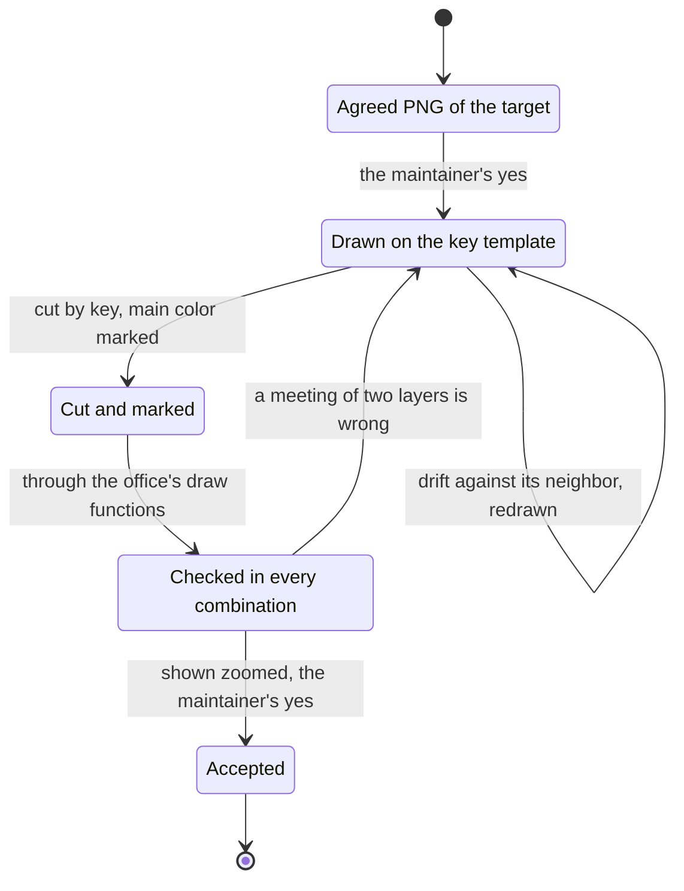

# ADR 0022 — Assets are drawn by image models from our own templates and checked by eye

<!-- STATE:BEGIN — generated by scripts/generate-adr-state.ts from the frontmatter; never edit by hand. -->

|                     |                                                                          |
| ------------------- | ------------------------------------------------------------------------ |
| **Status**          | accepted                                                                 |
| **Date**            | 2026-10-12                                                               |
| **Kind**            | workflow                                                                 |
| **Decision-makers** | lradermacher                                                             |
| **Supersedes**      | —                                                                        |
| **Superseded by**   | —                                                                        |
| **Analysis**        | —                                                                        |
| **Implementation**  | [PLAN_PIX-57_clean-branch.md](../plans/impl/PLAN_PIX-57_clean-branch.md) |
| **Cards**           | PIX-57 · PIX-58                                                          |

<!-- STATE:END -->

> **In short.** In the context of a public MIT repo whose office needs figures with free colors, wardrobe and
> motion, facing a Blender rebuild and part rigs that did not reach the approved look, generated output of different
> licenses and changes that broke the look when nobody looked, we decided that image models draw every asset from our
> own templates and style, a local video model makes every motion (what it melts, drawn states), and every result is
> checked by eye before it is shown, and against modelling or rigging by hand, to reach the approved HD office pixel
> style, accepting a license check per tool and drawings that need redrawing when they drift.

## Context and problem

From 2026-10-09 to 2026-10-12 the proof of concept PIX-65 built two base figures with idle and walk, faces, hair,
beards, a wardrobe of tops, jackets, trousers, skirts, outfits and shoes, and glasses and hats, all colored
at runtime. What worked: a base figure rendered from our approved template by a local image model with our own style
LoRA, motion from a local video model, every part drawn by an image model on a green-key template and cut by key.
What was measured and failed: a rebuild by eye in Blender, rigs of cut pixel parts, 3D rigs rendered as pixel art, a
figure LoRA, pose control, and code that clipped or redrew where two layers meet.

## Decision drivers

- What ships must be ours to license under MIT.
- The look the maintainer approved, reached by looking, not by a number.
- One local render at a time on the maintainer's machine.
- Every visual direction agreed before work is spent on it.

## Considered options

- **A — Drawn by image models from our own templates, animated by a local video model, checked by eye.**
- **B — As A, but output of an outside service only as a reference that never ships.**
- **C — Modelled and rigged by hand in Blender from a generated reference.**

## Decision

Chosen: **A**, sheet `pix57-clean-branch` of 2026-10-12, F2, because only it reached the approved look.

1. **A base figure comes from our own template and style.** The local image model renders the approved template with
   the style LoRA we trained on our own approved drawings; the result is accepted by the maintainer before anything
   is built on it. `[Prose: a base figure is made once per figure and accepted by eye]`
2. **Motion comes from the local video model; what it melts comes as drawn states.** A walk or another cycle is cut
   from a free clip, a gesture on the spot is a loop anchored on the same still at both ends. What the video model
   cannot move without melting it, a speaking mouth or typing fingers, is drawn as states on the approved still and
   swapped per frame. No part is stretched, rotated or moved like a puppet. `[Skill animate-figure]`
3. **A gesture is defined before its first render.** What moves, what stays still, the timing and the measured check
   stand in its card. `[Skill animate-figure]`
4. **A part is drawn, cut by key and recolored at runtime.** An image model draws it on a template whose free area is
   flat key green; it is cut by that key, kept as a grey layer with its main-color mark, and colored in the office.
   Marks such as our logo are drawn into the garment, never stamped by code. `[Skill figure-part]`
5. **Where two layers meet, the meeting is drawn.** A trouser exists once per shoe class, hair once under a hat; after
   the second rule that failed to clip or redraw a meeting, the input changes instead. `[Skill figure-part]`
6. **Drawings by an image model ship, with the tool's terms read first.** Every tool's license or terms are read from
   their source before its output enters the repo: OpenAI assigns its rights in output to the user (Terms of Use,
   effective 2026-01-01, section "Content"); the LTX-2 Community License claims no rights in output (point 5);
   Z-Image Turbo, Qwen-Image-Edit and its Lightning LoRA are Apache-2.0 (their model cards).
   `[Prose: a license is read, not measured]`
7. **Nothing from another game enters the repo:** no file, no traced shape, no name. `[Gate history guard denylist]`
8. **A local model renders one job at a time under the memory guard.** `[Gate verify-full: renderer spec]`
9. **A score checks a result; nothing is tuned towards it.**
   `[Prose: whether a value was tuned shows only in the session]`
10. **A result is looked at before it is shown or built on.** Zoomed, through the office's own draw functions, in
    light and dark colors; where two layers meet, in every combination; every new drawing against its approved
    neighbor. `[Skill figure-part · Skill animate-figure]`

### Consequences

- Good, because the approved look is reached in hours per garment instead of not at all.
- Good, because every color is free at runtime from one drawing.
- Bad, because an outside image service has its own quota, and its terms can change; point 6 reads them again for
  every new tool.
- Bad, because a drawing can drift from its neighbor and has to be compared and redrawn.

### Confirmation

The rule area `assets` carries points 2, 3, 5 and 7 to 10; `node scripts/check-rules.ts` and `scripts/probe-rules.sh`
check its form. The skill `figure-part` carries point 4, the skill `animate-figure` the steps of points 2 and 3;
points 1 and 6 are prose: a base figure is accepted once by eye, and a license is read per tool from its source
before its output enters the repo. The renderer spec covers the
lock and the guard; the history guard probe covers the denylist.

## Mechanics

The way of one part; every stop waits for the maintainer.

## Rejected

- **B — outside output only as a reference.** The drawings that reached the look are that output; the terms assign it
  to us.
- **C — modelled and rigged by hand in Blender.** The rebuild by eye did not reach the approved look, and a figure
  tuned towards a silhouette score of 0.91 came out bulky and faceless.
- **Rigs of cut pixel parts, 3D rigs rendered as pixel art, a figure LoRA, pose control.** Each was measured in
  PIX-58, PIX-64 or PIX-65 and broke the look or the pose.
- **Code that clips or redraws where layers meet.** Four rounds of rules on hems and on hair under hats each looked
  worse than the drawn meeting.
- **Image-to-3D services.** Rights unclear, and the maintainer rejected them outright.
