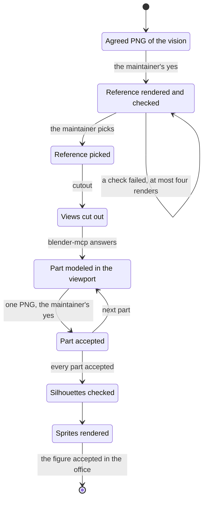

# ADR 0022 — Assets are our own work, made by eye from a checked reference

<!-- STATE:BEGIN — generated by scripts/generate-adr-state.ts from the frontmatter; never edit by hand. -->

|                     |                                                                                    |
| ------------------- | ---------------------------------------------------------------------------------- |
| **Status**          | accepted                                                                           |
| **Date**            | 2026-10-04                                                                         |
| **Kind**            | workflow                                                                           |
| **Decision-makers** | lradermacher                                                                       |
| **Supersedes**      | —                                                                                  |
| **Superseded by**   | —                                                                                  |
| **Analysis**        | —                                                                                  |
| **Implementation**  | [PLAN_PIX-57_asset-development.md](../plans/impl/PLAN_PIX-57_asset-development.md) |
| **Cards**           | PIX-57                                                                             |

<!-- STATE:END -->

> **In short.** In the context of a public MIT repo whose office needs characters and props, facing generated assets
> of unclear rights, another game whose look inspired ours, an image model that can exhaust the machine's memory and
> a rebuild that was tuned towards a score instead of looked at, we decided that every asset is our own work, built by
> eye in Blender from a checked reference and accepted part by part, and against shipping generated assets or
> steering a model by a number, to own what ships and to reach the reference's quality, accepting slower work per
> asset.

## Context and problem

PIX-57 builds the asset pipeline: a local Qwen reference, a cutout, a Blender rebuild and pixel sprites. On
2026-10-04 the maintainer rejected generated models for shipping (sheet asset-source, F2), adopted the layered part
system of the game that inspired the look while forbidding any of its files or its name in the repo, and asked for a
vision agreed as one PNG before anything is built. The same day an unguarded image-model loop ran the MacBook out of
memory, and a figure tuned automatically towards a silhouette score of 0.91 came out bulky and faceless, because the
work ran without a viewport.

## Decision drivers

- What ships must be ours to license under MIT.
- The reference's quality, reached by looking, not by a measure that cannot see a face.
- One local render at a time on the maintainer's machine.
- Every visual direction agreed before work is spent on it.

## Considered options

- **A — Own assets, made by eye from a checked reference, accepted part by part.**
- **B — Generated assets from image-to-3D services.**
- **C — Scripted rebuilds steered by a similarity score.**

## Decision

Chosen: **A**, sheet pix57-rules-assets of 2026-10-04, F1 and F2.

1. An image or model a generator made never ships; it is a reference only. `[Agent adversarial-review]`
2. Nothing from another game enters the repo: no file, no traced shape, no name. `[Gate history guard denylist]`
3. The image model renders one image at a time under the memory guard. `[Gate verify-full: renderer spec]`
4. A figure is modeled with the viewport: blender-mcp answers before the first change. `[Skill blender-character]`
5. Every part is accepted as one PNG before the next starts. `[Skill blender-character]`
6. A score checks a result; nothing is tuned towards it. `[Prose]`
7. A visual result is looked at before it is shown or built on. `[Prose]`
8. A visual of any kind is agreed as one cheap PNG before it is built; this one stands in the workflow rule, because
   it holds for screens and scenes as well. `[Prose]`

### Consequences

- Good, because everything that ships is licensed by its makers.
- Good, because the maintainer sees each part before work builds on it.
- Bad, because a figure takes more rounds of looking and asking than a scripted run.

### Confirmation

The rule area `assets` and the workflow rule carry the statements; `node scripts/check-rules.ts` and
`scripts/probe-rules.sh` check their form. The renderer spec covers the lock and the guard; the history guard probe
covers the denylist.

## Mechanics

The way of one figure; every stop waits for the maintainer.

## Rejected

- **B — generated assets.** Rights unclear, and the maintainer rejected them outright.
- **C — steered by a score.** The silhouette score rewards mass where parts overlap in the reference; the tuned figure
  scored 0.91 and looked wrong.
