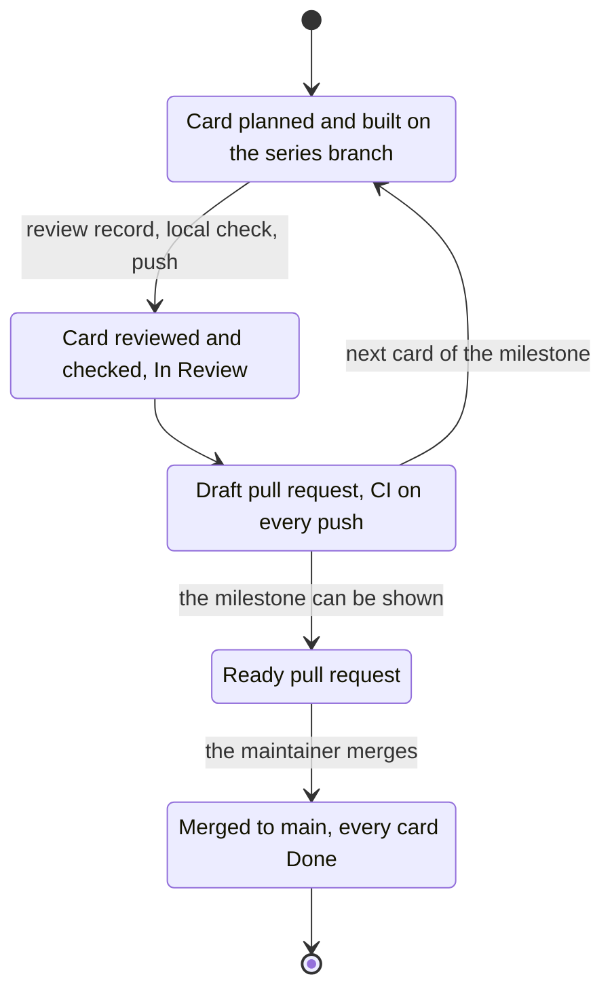

# ADR 0024 — A series collects on its branch until its milestone can be shown

<!-- STATE:BEGIN — generated by scripts/generate-adr-state.ts from the frontmatter; never edit by hand. -->

|                     |                                                                                                                                                                      |
| ------------------- | -------------------------------------------------------------------------------------------------------------------------------------------------------------------- |
| **Status**          | accepted                                                                                                                                                             |
| **Date**            | 2026-10-13                                                                                                                                                           |
| **Kind**            | workflow                                                                                                                                                             |
| **Decision-makers** | lradermacher                                                                                                                                                         |
| **Supersedes**      | [0002](0002-feature-flow.md) · [0004](0004-git-flow-and-history-guard.md) (the end of a series and its pushes only; of ADR 0002 point 3 and ADR 0004 points 1 and 3) |
| **Superseded by**   | —                                                                                                                                                                    |
| **Analysis**        | —                                                                                                                                                                    |
| **Implementation**  | [PLAN_PIX-75_collection-branch.md](../plans/impl/PLAN_PIX-75_collection-branch.md)                                                                                   |
| **Cards**           | PIX-75 · PIX-78                                                                                                                                                      |

<!-- STATE:END -->

> **In short.** In the context of a series of cards that shares one branch and one pull request, facing merges to
> `main` of parts that cannot be shown on their own, we decided that a series collects on its branch with a draft pull
> request until its milestone can be shown and is then merged once, and against a merge per series or a separate
> integration branch, to put on `main` only what stands on its own, accepting a large final pull request and cards that
> wait in In Review until that merge.

## Context and problem

ADR 0002 point 3 and ADR 0004 point 1 let a series of cards share one branch and one pull request, but they do not say
when a series ends. On 2026-10-13 the first series (PIX-7, 56, 57, 66, 71 and 58, among others) stood ready as pull
request #2 with 893 files: the skeleton, the setup, the asset chain and the base figures, but no office anyone could
walk through.
The maintainer judged that a merge to `main` makes no sense before a whole feature can be delivered. The product plan
already cuts the work that way: each milestone is one epic and can be shown on its own.

## Decision drivers

- `main` holds what can be shown on its own, not a half-built feature.
- Every card is still checked alone: plan, review and the maintainer's local check.
- CI measures the branch on every push, not only at the end.

## Considered options

- **A — The series branch collects, its pull request a draft until the milestone can be shown.**
- **B — A separate integration branch, with one pull request per card into it.**
- **C — Merge each series to `main` when its cards are done.**

## Decision

Chosen: **A**, sheet `collection-branch` of 2026-10-13, F1 = a, F2 = a, F3 = yes. Only A keeps the branch hook, the
push window and the cards one after another as they are, and still keeps `main` to what stands on its own.

1. **A series collects on its branch until its milestone can be shown.** Its pull request stays a draft until then;
   whether the milestone can be shown is the maintainer's call. `[Prose: whether a milestone can be shown is the
   maintainer's judgment]`
2. **It is merged to `main` once, by the maintainer.** `[Hook guard-state]`
3. **Every card on the branch is still built and checked on its own, then pushed into the draft.** Its plan, its
   independent review with its record and the maintainer's local check stay as ADR 0002 and ADR 0004 point 4 say; then
   it is pushed in the window the maintainer opens, once per card, instead of once per series as in ADR 0004 point 3.
   The hook gate-before-pr checks the record only when the pull request is created; for every later card the code skill
   and the maintainer's window carry it, the draft check included. `[Gate ticket.ts open · Agent adversarial-review ·
   Skill code · Hook push-window]`
4. **A finished card waits in In Review until that merge.** All cards of the series go to Done together after it.
   `[Skill code]`
5. **CI measures every push through the draft.** The workflow runs on every pull request, drafts included.
   `[Config .github/workflows/ci.yml]`
6. **The current series ends with M1, "Walk through your own office".** Its branch is
   `feat/pix-7-skeleton-toolchain` with pull request #2; the branch keeps its name, because a new one would cost the
   open pull request. `[Prose: a milestone is named once, here]`

### Consequences

- Good, because `main` gets a feature that can be shown, never a skeleton without one.
- Good, because each card is still planned, reviewed and checked alone.
- Bad, because the final pull request is large; its description carries a reading order and names what not to read.
- Bad, because cards wait in In Review for a long time, and Done comes only with the milestone.
- Bad, because ADR 0004's trunk-based flow now has one long-lived branch per milestone. A change that reaches `main`
  meanwhile comes into the branch by merging `main` into it, never by a rebase.
- Bad, because no hook keeps the pull request a draft or checks the record before a later card's push; the code
  skill and the maintainer's window carry both.

### Confirmation

At each push the pull request of a collecting series is checked by hand to be a draft
(`gh pr view --json isDraft`); there is no probe, because the draft state lives on GitHub. CI runs on each push to it,
and the branch hook, the push window and the review record per card measure the rest as before.

## Mechanics

## Rejected

- **B — A separate integration branch.** Every card would need its own branch from it and its own pull request, the
  branch hook and ADR 0004 would change, and the maintainer would review in two places.
- **C — Merge each series when its cards are done.** That put pull request #2 on the way to `main` with a skeleton
  and figures but no office, which is what the maintainer rejected.
